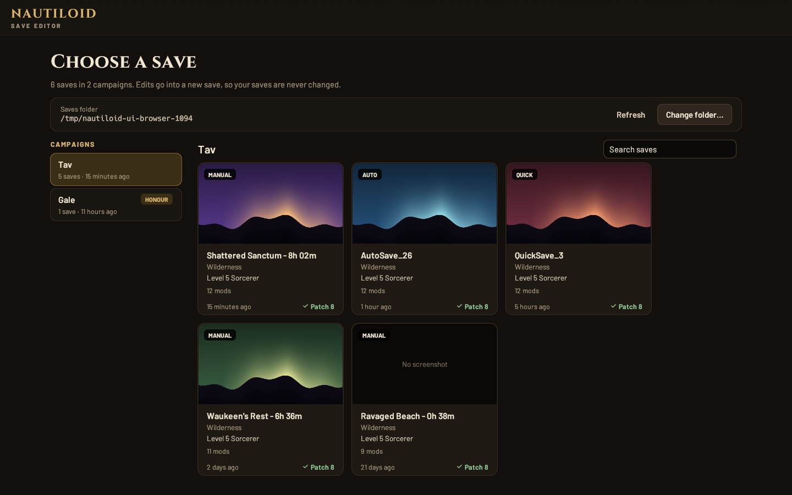

<p align="center"></p>

# Nautiloid Save Editor

A desktop save editor for **Baldur's Gate 3** (Patch 8) on Windows, macOS and Linux, including
Steam Deck.


The save you open is never changed. Edits go into a new save, which the game lists beside the
original, and the new save is read back and checked before the editor keeps it.

## What it can change

The party, and the companions waiting at camp:

- **Experience**, for each character in the party. A companion at camp has none of their
  own: the game awards it when they join.
- **Level-ups.** The editor entitles a character to the next level, and the game offers the
  level-up and takes you through the choices.
- **Ability points**: the points put into each ability at character creation. The game adds
  the character's other bonuses on top.
- **Gold**, for a character who already carries some.
- **Inspiration**, once the party has earned a point. The game allows 4; more needs a mod
  that lifts that, and the app says so.

- **Inventory**: how many each stack holds, for every character and the camp chest. Food
  shows the camp supplies it is worth, and the game's supplies total follows it. Items have
  the names players see, read from your own install of the game; nothing from the game is
  shipped with the editor. Items added by mods keep their internal names for now, and can be
  added only as copies of one the save already has.
- **Adding items**, any of the game's items, searched by name. A new item is a copy of the
  closest item anywhere in the save (the same item if anyone has one, else one like it,
  equipped or not, the party's or anyone else's), made into the item you pick. A scroll is
  made from another scroll where the save has one, and the game gives it its spell. New
  items are not marked as wares, even when what they are copied from is. An item that stacks goes in as one stack of
  as many as you ask for; a single item has a + beside it to add more. New items go at the
  end of the inventory.
- **Approval**: what each companion thinks of your character.
- **Story**, to look at only: the counters the story keeps, its hidden tallies of points
  (such as those toward Shadowheart sparing the Nightsong, with what earned each), and the
  flags it has set, under the game's own names.

Each of these has been changed in a save that then loaded in the game (build
`4.1.1.7631656`) with the new value. For a companion at camp that is so for ability points;
a level-up or a change of gold there is the same field as a party member's but has not been
tried. Adding items was tried in every way the app uses: copies of what the holder carries
and of what NPCs carry or wear, items made from another of the same kind or of another kind,
new stacks, scrolls of other spells (from another scroll or from anything else), and copies
between a character and the camp chest.

An exported quicksave or autosave is written as a manual save, so the game's load menu lists
it by its name (it lists its own autosaves as "Autosave 4" whatever they're called). An
Honour Mode save stays one; load it from the game's main menu, as the game won't load a
second save of an Honour Mode playthrough while a game is running.

It also lists the mods a save asks for, marked by whether your game has them active. That
list is read only: the game's own mod manager is the place to change it.

Saves from before Patch 8 are listed but can't be edited.

- [docs/HOW-TO-USE.md](docs/HOW-TO-USE.md): a step-by-step guide, with pictures.
- [SCOPE.md](SCOPE.md): what the editor will and won't do, the build order and where it stands.
- [docs/FORMAT.md](docs/FORMAT.md): what is known about the save format.
- [docs/TECHNICAL.md](docs/TECHNICAL.md): how the editor works, for anyone forking or
  extending it.

## Getting it

The app is built for Windows, Linux and macOS whenever `main` changes. On the repository's
**Actions** page, open the latest **CI** run and download `nautiloid-save-editor-windows-x64`,
`nautiloid-save-editor-linux-x64` or `nautiloid-save-editor-macos-arm64` from its artifacts.

- **Windows:** unzip and run `nautiloid-save-editor.exe`. The app isn't signed, so Windows may
  show "Windows protected your PC" the first time; choose **More info**, then **Run anyway**.
- **Linux and Steam Deck:** unpack the archive and run `nautiloid-save-editor`. It needs a
  desktop with OpenGL and `libxkbcommon-x11`, which desktop systems have. Choosing a folder
  uses the desktop's file chooser (the XDG portal, or `zenity`); without one, type the
  folder's path. Dropping a folder onto the window works under X11, not Wayland.
- **macOS (Apple silicon):** unzip it and open `Nautiloid Save Editor.app`. The app isn't
  notarized, so the first time macOS refuses to open it: choose **Done**, then **Open Anyway**
  in System Settings → Privacy & Security. That build has not been run on a Mac yet.

Each download includes the guide as a PDF, `How to use Nautiloid.pdf`, and
`THIRD-PARTY-LICENSES.txt`, the licences of the libraries and fonts built into the app.

Or build it from source with [Rust](https://rustup.rs) 1.88 or later:

```bash
cargo run --release
```

## Using it

1. Start the app. It looks for the game's saves folder and lists the saves by campaign. If it
   doesn't find the folder, choose it, type its path, or drop a save's folder onto the
   window.
2. Open a save and change what you want. Every change is listed in the Changes panel, where
   each can be reverted on its own. Undo and redo work as usual.
3. Choose **Export as a new save**, and give the save a name. It is written beside the
   original, and the game lists it under that name in **Load Game**.

For every step with pictures, see [How to use Nautiloid](docs/HOW-TO-USE.md).



The game keeps its saves here:

| System | Folder |
| --- | --- |
| Windows | `%LOCALAPPDATA%\Larian Studios\Baldur's Gate 3\PlayerProfiles\Public\Savegames\Story` |
| macOS | `~/Documents/Larian Studios/Baldur's Gate 3/PlayerProfiles/Public/Savegames/Story` |
| Steam Deck, the game's own Linux build | `~/.local/share/Larian Studios/Baldur's Gate 3/PlayerProfiles/Public/Savegames/Story` |
| Linux and Steam Deck under Proton | the same path as Windows, inside the game's Proton prefix (`steamapps/compatdata/1086940`, in the Steam library the game is installed in) |

## Looking inside a save

`nautiloid-cli` is a command-line tool for working out the format. A save is a `.lsv` file or
the folder that holds one.

```bash
cargo run --release --bin nautiloid-cli -- info "path/to/save folder"
```

Run it without arguments for the other commands, among them `list`, `dump`, `find`, `diff`,
`party`, `items`, `edit`, `add`, `tables`, `rows`, `entity`, `pointer-check` and `catalog`.
[docs/TECHNICAL.md](docs/TECHNICAL.md) says what each is for.

## Tests

```bash
cargo test
```

The interface is tested without a window: the tests click through the app and draw each screen
to `target/ui-snapshots/`.

Real saves are private and are not in the repository. To run the checks against your own, point
`NAUTILOID_SAVES` at a folder of save folders:

```bash
NAUTILOID_SAVES="path/to/Savegames/Story" cargo test
```

Unofficial. Not affiliated with or endorsed by Larian Studios.

Licensed under GPL-3.0-only; see [LICENSE](LICENSE).
