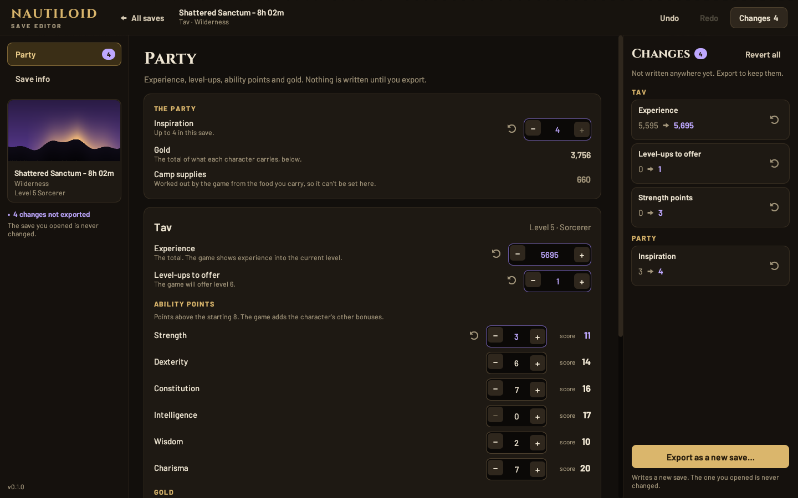

<p align="center"></p>

# Nautiloid Save Editor

A desktop save editor for **Baldur's Gate 3** (Patch 8) on Windows, macOS and Linux, including
Steam Deck.



The save you open is never changed. Edits go into a new save, which the game lists beside the
original, and the new save is read back and checked before the editor keeps it.

## What it can change

The party, and the companions waiting at camp:

- **Experience**, for each character in the party. A companion at camp has none of their
  own: the game awards it when they join.
- **Level-ups.** The editor entitles a character to the next level, and the game offers the
  level-up and takes you through the choices.
- **Ability points**: the points put into each ability at character creation. The game adds
  the character's other bonuses on top.
- **Gold**, for a character who already carries some.
- **Inspiration**, once the party has earned a point.

- **Inventory**: how many each stack holds, for every character and the camp chest. Food
  shows the camp supplies it is worth, and the game's supplies total follows it. Items have
  the names players see, read from your own install of the game; nothing from the game is
  shipped with the editor. Items added by mods keep their internal names for now.
- **Approval**: what each companion thinks of your character.

Each of these has been changed in a save that then loaded in the game (build
`4.1.1.7631656`) with the new value. For a companion at camp that is so for ability points;
a level-up or a change of gold there is the same field as a party member's but has not been
tried.

It also lists the mods a save asks for, marked by whether your game has them active. That
list is read only: the game's own mod manager is the place to change it.

Saves from before Patch 8 are listed but can't be edited.

- [SCOPE.md](SCOPE.md): what the editor will and won't do, the build order and where it stands.
- [docs/FORMAT.md](docs/FORMAT.md): what is known about the save format.

## Getting it

The app is built for Windows and Linux whenever `main` changes. On the repository's **Actions**
page, open the latest **CI** run and download `nautiloid-save-editor-windows-x64` or
`nautiloid-save-editor-linux-x64` from its artifacts.

- **Windows:** unzip and run `nautiloid-save-editor.exe`. The app isn't signed, so Windows may
  show "Windows protected your PC" the first time; choose **More info**, then **Run anyway**.
- **Linux and Steam Deck:** unpack the archive and run `nautiloid-save-editor`. It needs a
  desktop with OpenGL and `libxkbcommon-x11`, which desktop systems have.
- **macOS:** built only for version tags, or when the CI workflow is run by hand with the macOS
  box ticked. That build has not been run on a Mac yet.

Or build it from source with [Rust](https://rustup.rs) 1.88 or later:

```bash
cargo run --release
```

## Using it

1. Start the app. It looks for the game's saves folder and lists the saves by campaign. If it
   doesn't find the folder, choose it, or drop a save's folder onto the window.
2. Open a save and change what you want. Every change is listed in the Changes panel, where
   each can be reverted on its own. Undo and redo work as usual.
3. Choose **Export as a new save**, and give the save a name. It is written beside the
   original, and the game lists it under that name in **Load Game**.


The game keeps its saves here:

| System | Folder |
| --- | --- |
| Windows | `%LOCALAPPDATA%\Larian Studios\Baldur's Gate 3\PlayerProfiles\Public\Savegames\Story` |
| macOS | `~/Documents/Larian Studios/Baldur's Gate 3/PlayerProfiles/Public/Savegames/Story` |
| Linux, Steam Deck | the same path as Windows, inside the game's Proton prefix (`steamapps/compatdata/1086940`) |

## Looking inside a save

`nautiloid-cli` is a command-line tool for working out the format. A save is a `.lsv` file or
the folder that holds one.

```bash
cargo run --release --bin nautiloid-cli -- info "path/to/save folder"
```

Run it without arguments for the other commands: `list`, `dump`, `find`, `diff`, `party`,
`edit`, `tables`, `rows`, `check`, `extract`, `rewrite` and `set`.

## Tests

```bash
cargo test
```

The interface is tested without a window: the tests click through the app and draw each screen
to `target/ui-snapshots/`.

Real saves are private and are not in the repository. To run the checks against your own, point
`NAUTILOID_SAVES` at a folder of save folders:

```bash
NAUTILOID_SAVES="path/to/Savegames/Story" cargo test
```

Unofficial. Not affiliated with or endorsed by Larian Studios.

Licensed under GPL-3.0-only; see [LICENSE](LICENSE).
