# How to use Nautiloid

Nautiloid changes things in your Baldur's Gate 3 saves: experience, level-ups, ability
points, gold, approval, how many of something you have, and what items your party carries.

**Your saves are safe.** Nautiloid never changes a save you open. When you're done, it writes
your changes into a *new* save beside the old one, and you load that new save in the game.
If you don't like the result, load the old save instead.

The pictures here use made-up sample saves, so the names and numbers won't match yours.

Nautiloid is unofficial. It isn't made by, affiliated with, or endorsed by Larian Studios.

## Contents

1. [Start the app](#1-start-the-app)
2. [Open a save](#2-open-a-save)
3. [Change your party](#3-change-your-party)
4. [Check and undo your changes](#4-check-and-undo-your-changes)
5. [Change and add items](#5-change-and-add-items)
6. [Change approval](#6-change-approval)
7. [See what the story is tracking](#7-see-what-the-story-is-tracking)
8. [See your mods](#8-see-your-mods)
9. [Save your changes and play](#9-save-your-changes-and-play)
10. [If something looks wrong](#10-if-something-looks-wrong)

## Before you start

- Make a save in the game first, so you have a fresh one to work on.
- Only saves from the current version of the game (Patch 8) can be changed. Older saves are
  shown dimmed and marked **⚠ Can't be edited**.
- You can leave the game running. Before loading your new save, go back to the game's main
  menu, so it sees the new save.

## 1. Start the app

1. Unzip the download into a folder of its own, anywhere you like. Nothing needs installing.
2. Open that folder and run **nautiloid-save-editor** (`nautiloid-save-editor.exe` on
   Windows, **Nautiloid Save Editor** on a Mac).

On Windows, a blue box saying "Windows protected your PC" may appear the first time, because
the app isn't signed. Click **More info**, then **Run anyway**.

On a Mac, the first time, macOS says it can't check the app for malware, because the app isn't
registered with Apple. Click **Done**, open **System Settings**, then **Privacy & Security**,
scroll down and click **Open Anyway** beside the app's name, and confirm. After that it opens
normally.

On Windows and Linux the folder also holds **nautiloid-cli**, a tool for looking inside saves
from a terminal. You don't need it to use the editor.

## 2. Open a save

When the app starts, it finds your saves by itself and shows them, grouped by playthrough.

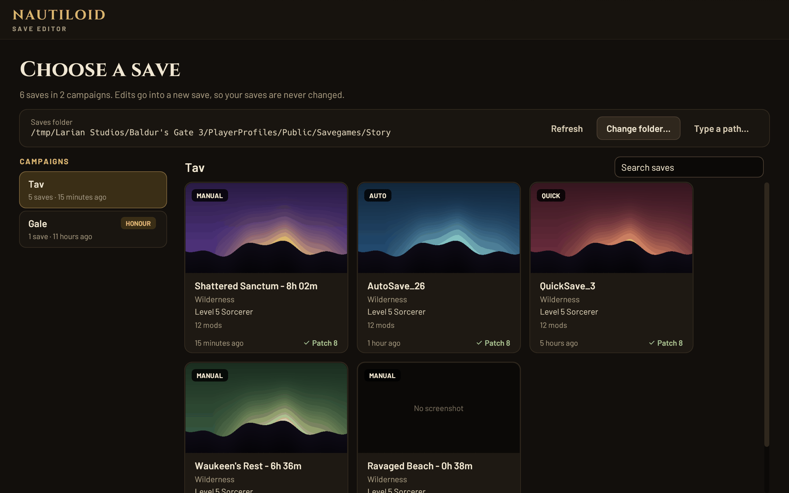

1. On the left, click the playthrough (the **campaign**). Each is named after its main
   character.
2. On the right, click the save you want to change. Each card shows where you saved, your
   level, and how long ago. The label on top says whether it is a save you made yourself
   (**Manual**), a **Quick** save or an **Auto** save. A green **✓ Patch 8** means it can be
   changed.

Can't see your saves? Click **Change folder…** and pick the folder the game keeps them in,
or click **Type a path…** and type or paste its path:

| Computer | Folder |
| --- | --- |
| Windows | `%LOCALAPPDATA%\Larian Studios\Baldur's Gate 3\PlayerProfiles\Public\Savegames\Story` |
| Mac | `~/Documents/Larian Studios/Baldur's Gate 3/PlayerProfiles/Public/Savegames/Story` |
| Steam Deck, with the game's own Linux version | `~/.local/share/Larian Studios/Baldur's Gate 3/PlayerProfiles/Public/Savegames/Story` |
| Linux and Steam Deck, with the Windows version | The Windows folder, inside `steamapps/compatdata/1086940` in the Steam library the game is in |

On Windows you can paste the first line into the address bar of File Explorer. You can also
drag a single save's folder onto the app's window to open it.

On Linux, **Change folder…** needs your desktop's file chooser. If nothing opens, use **Type
a path…** instead. Dragging a folder onto the window doesn't work under Wayland.

## 3. Change your party

A save opens on the **Party** tab. Every party member has a card, and so does each companion
waiting at camp.

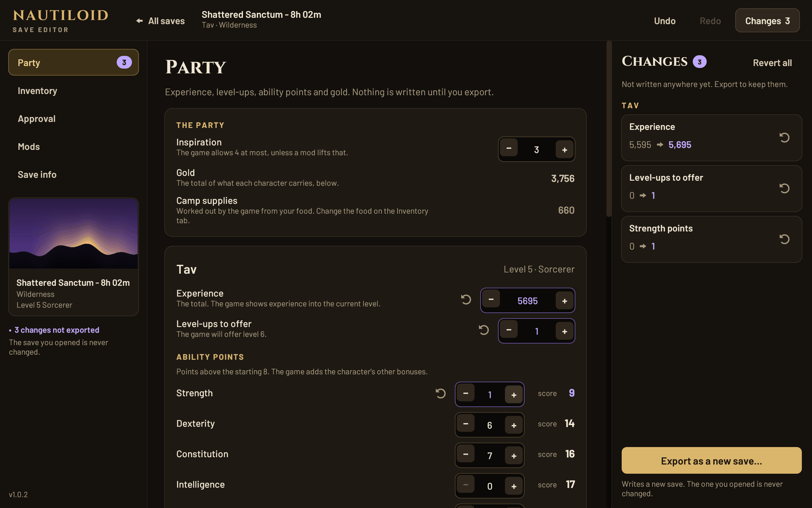

Use **−** and **+** to change a number, or click the number and type a new one.

- **Experience**: the character's total experience.
- **Level-ups to offer**: set this to 1, and the next time you load the save the game offers
  that character a level-up. You make the choices in the game, as usual.
- **Ability points**: the points put into each ability when the character was made, above
  the starting 8. The **score** beside it shows what the game will show, with the
  character's other bonuses added.
- **Gold**: how much gold the character carries. A character who carries none can't be given
  any here.
- **Inspiration** (at the top): your party's Inspiration points. The game allows 4 at most.
  You can set more, but only if you play with a mod that lifts that limit; the app warns you
  when you pass 4.

Companions at camp have no experience of their own: the game gives them the party's when
they join.

## 4. Check and undo your changes

Everything you change is listed in the **Changes** panel on the right, with the old and new
values. Nothing is saved yet.

- To put one thing back, click **⟲** beside it.
- To put everything back, click **Revert all**.
- **Undo** and **Redo** are at the top, or press **Ctrl+Z** and **Ctrl+Y** (on a Mac,
  **⌘Z** and **⌘⇧Z**).

The numbers beside the tab names on the left show how many changes are on each tab.

## 5. Change and add items

Click **Inventory**. Pick whose things to see with the buttons at the top: each character,
and the **Camp chest**.

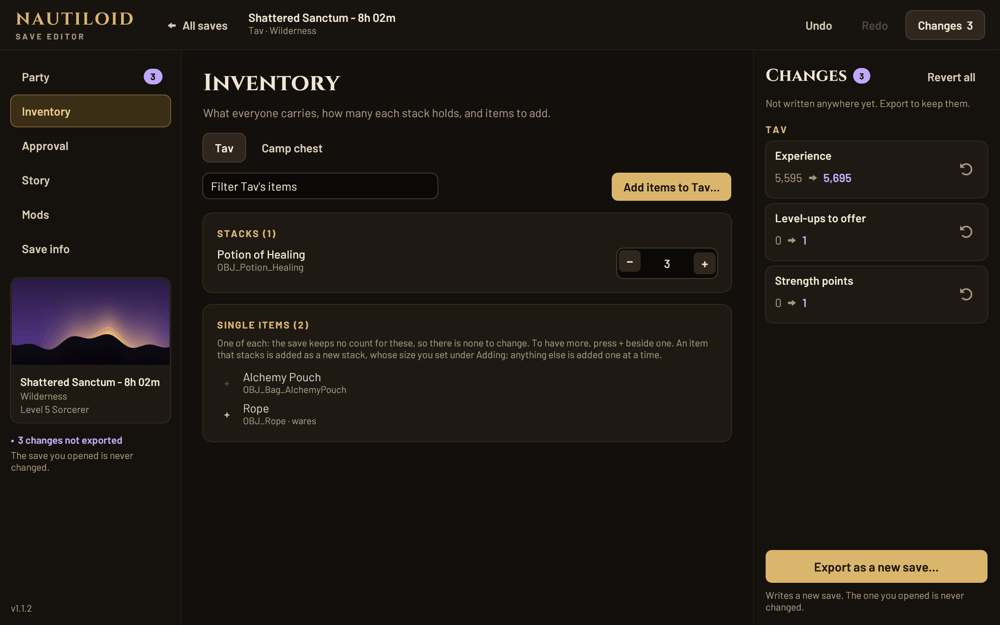

- **Stacks** are things you have several of, like potions. Change how many with **−** and
  **+**.
- **Single items** are one of each. The game keeps no count for these, so there's no number
  to change. To have more of one, press the **+** beside it.
- **wares** under an item means it is marked to sell, as in the game.

### Find an item and add it

Type in the **Filter** box. It shows what this character already has that matches, and
underneath, matching items from the game, each with an **Add** button.

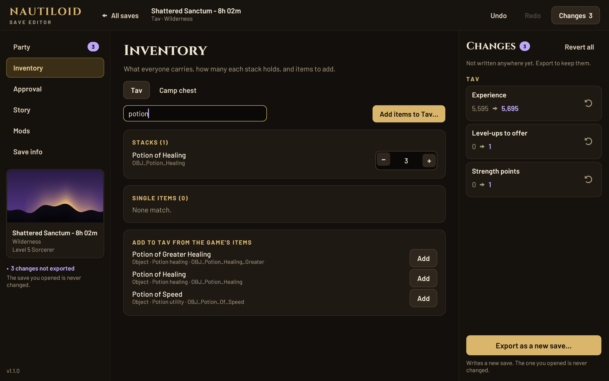

For a longer list, click **Add items to Tav…** (it says the character's name). Type part of a
name, and click **Add** beside what you want. Click **Add** again for more. Click **Done**
when you're finished.

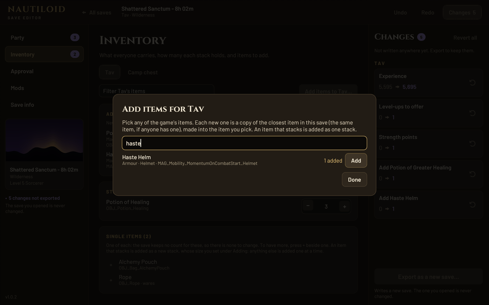

The names come from your copy of the game, so the app needs to find the game first (see
[If something looks wrong](#9-if-something-looks-wrong)).

### Check what you're adding

What you've picked is listed under **Adding**, at the top of the Inventory tab.

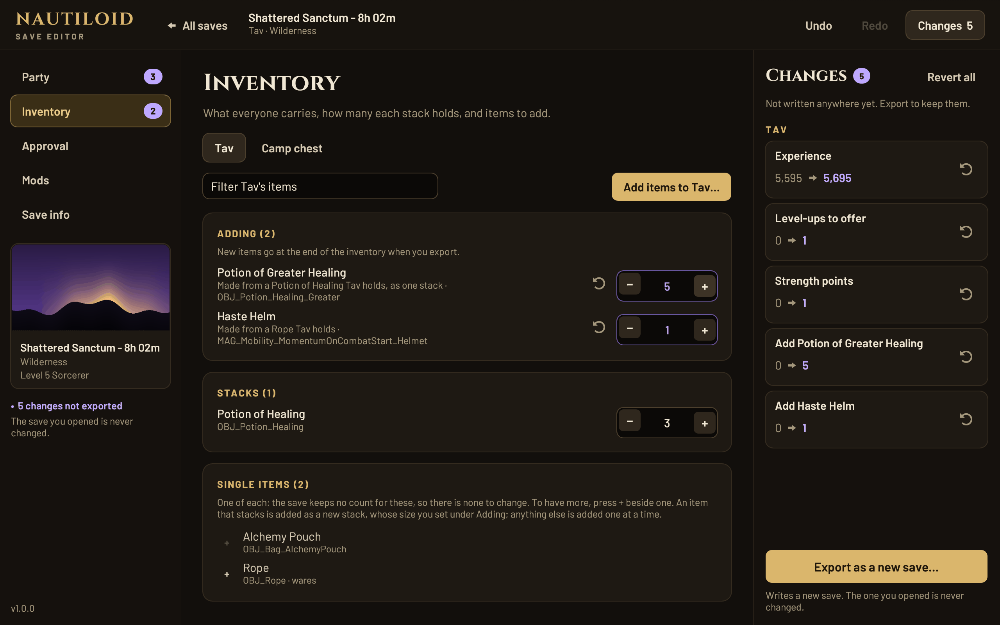

- Change how many with **−** and **+**. Items that stack, like potions and scrolls, are added
  as one stack of that many. Other items are added one at a time.
- Press **⟲** to take an item off the list.
- New items appear at the end of the character's inventory in the game.

A few things to know:

- **Bags, chests and other containers can't be added**, nor the few other items the game
  gives a hidden inventory of their own, such as the Mysterious Artefact. Explosive barrels
  can be added. Like the game's own, they show a weight of 0.
- An item marked as a **story item** shows a warning. Quests sometimes expect there to be only
  one of these, so a second one may confuse them.
- Items that come from **mods** show a rough name made from their internal name, instead of
  their proper name, and can't be found under **Add items…**. If someone already carries
  one, the **+** beside it adds copies of it. Keep the mod active: like the original, a copy
  needs it.

## 6. Change approval

Click **Approval** to see what each companion thinks of your character, from −50 (they hate
you) to 100 (they adore you). Change it with **−** and **+**.

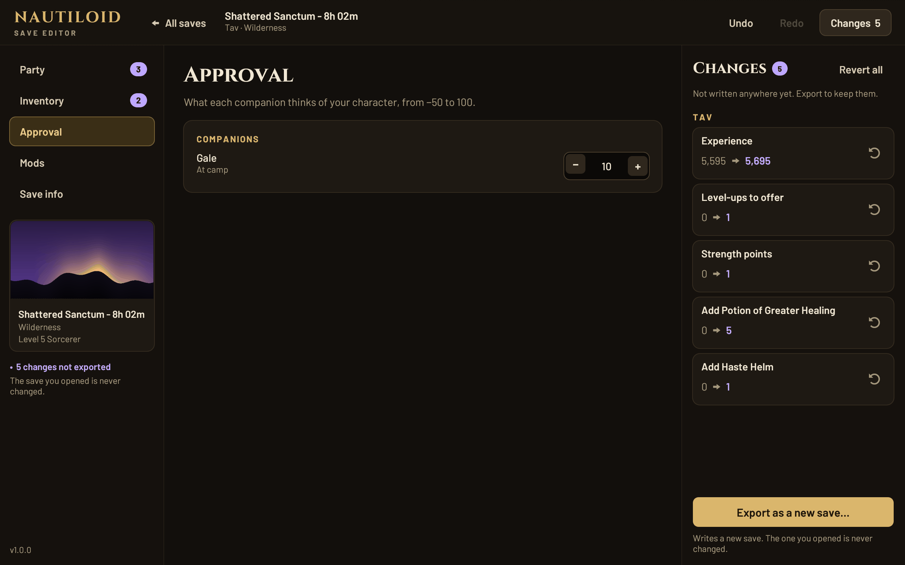

## 7. See what the story is tracking

Click **Story** to see things the game keeps count of but never shows you. This tab only
shows them: nothing on it can be changed.

- **Points the story is counting.** Some outcomes depend on a hidden tally. The best known is
  whether Shadowheart will spare the Nightsong: each thing that earns a point is listed, with
  a green dot once it has happened, and the total beside it.
- **Counters.** Other numbers the story keeps, such as how many times you have rested at camp.
- **Flags.** Everything the story has marked as having happened in this playthrough. Type in
  the box to filter them, for example a companion's name.

Everything here is under the game's own internal names, so some of it reads oddly, and names
can give away parts of the story you haven't reached.

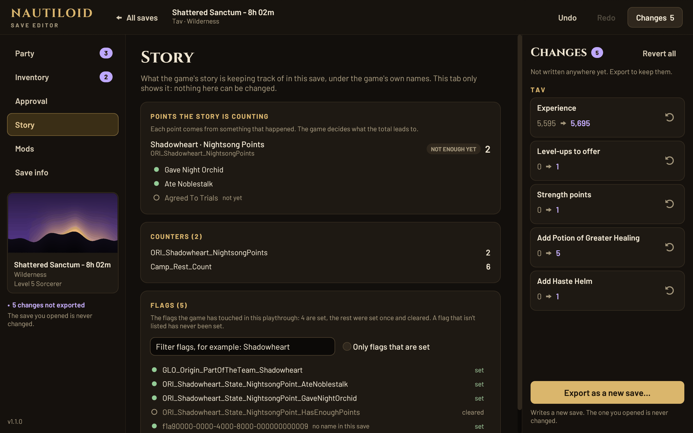

## 8. See your mods

Click **Mods** to see the mods this save was made with. **Active** means your game has the
mod turned on; **Not active** means it doesn't, and the game will warn you when you load the
save. This list can't be changed here: use the game's own mod manager.

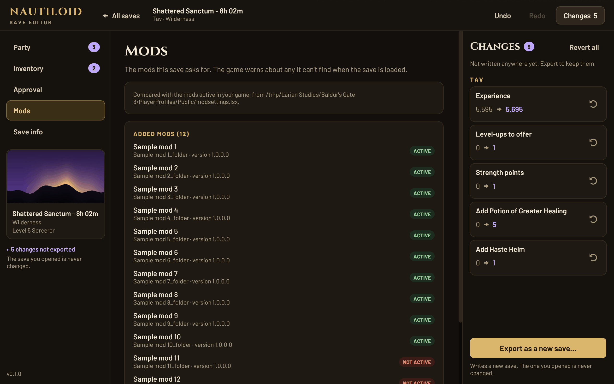

## 9. Save your changes and play

1. Click **Export as a new save…** at the bottom right (or press **Ctrl+E**).
2. Type a name for the new save, or keep the one suggested. This is the name the game will
   show.
3. Click **Export**.

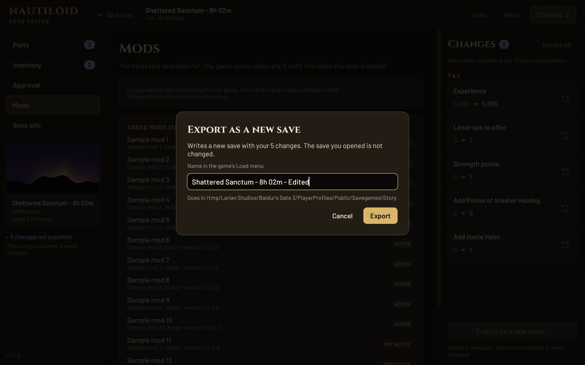

The app writes the new save, checks it, and opens it, so you can carry on changing things.
Click **Show in folder** to see where it went.

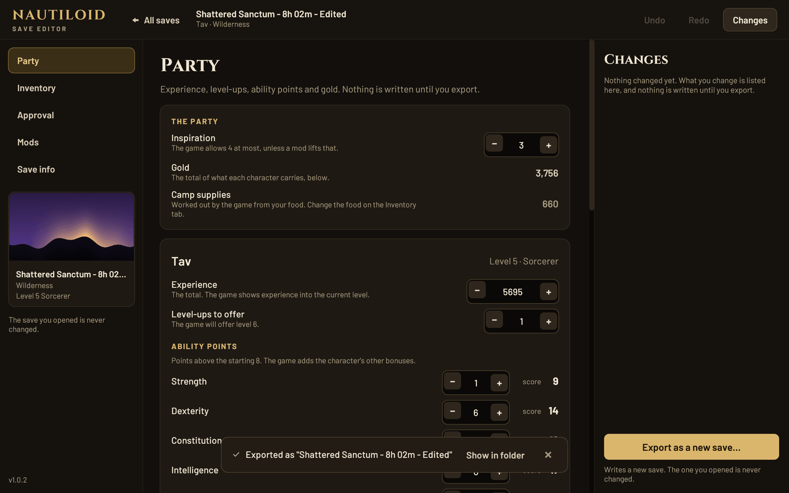

Now, in the game:

1. Go to the main menu and choose **Load Game**.
2. Open your playthrough. Your new save is listed under the name you gave it.
3. Load it. If you added level-ups, the game offers them.

## 10. If something looks wrong

**Items have odd names, and "Add items" is greyed out.** The app couldn't find your game,
so it shows the game's internal names. Click **Choose game folder…** and pick the folder the
game is installed in (the one called `Baldurs Gate 3`, usually in
`steamapps/common`).

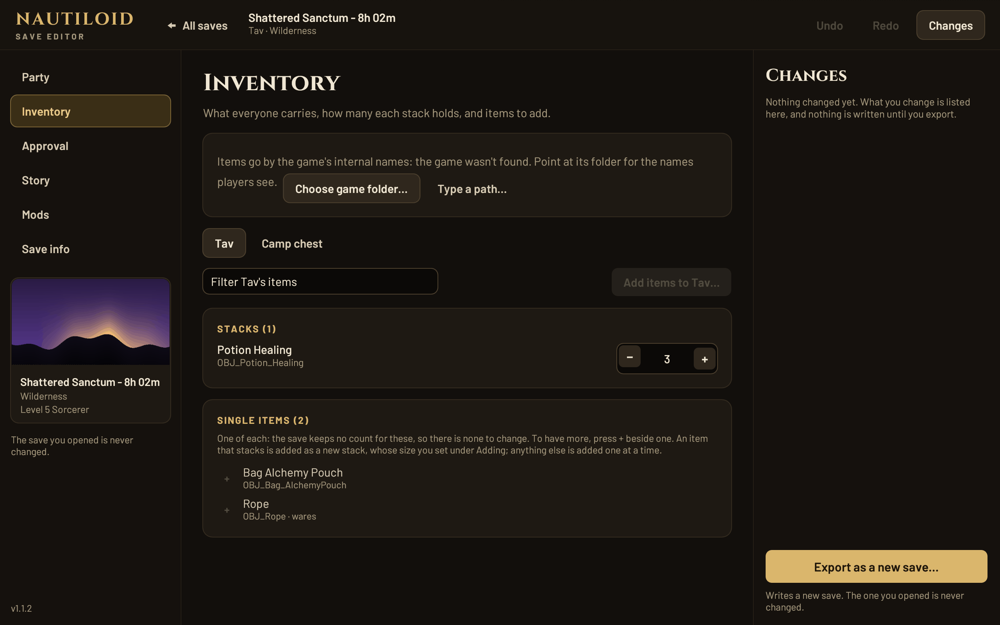

**A save is dimmed and says "Can't be edited".** It's from an older version of the game.
Load it in the game and save again, and the new save can be changed.

**An ability score in the game is different from what the app showed.** The game works scores
out again when it loads, from the points and from the character's race, class and gear. The
points you set are what count.

**The camp supplies total didn't change.** The game counts it up from your food when it
loads. Change how much food you have on the Inventory tab instead.

**The game won't load an Honour Mode save** and says you can't reload a previous save while
playing in Single Save mode. Honour Mode allows one save per playthrough, so the game won't
load another one while a game is running. Go back to the game's main menu and load it from
there. Keep a copy of your original save folder somewhere safe too: it hasn't been checked
which of the two saves the game writes over when you next save.

**Something else went wrong.** Load your original save: it was never changed. Then report
the problem where you downloaded the app, saying what you changed.
